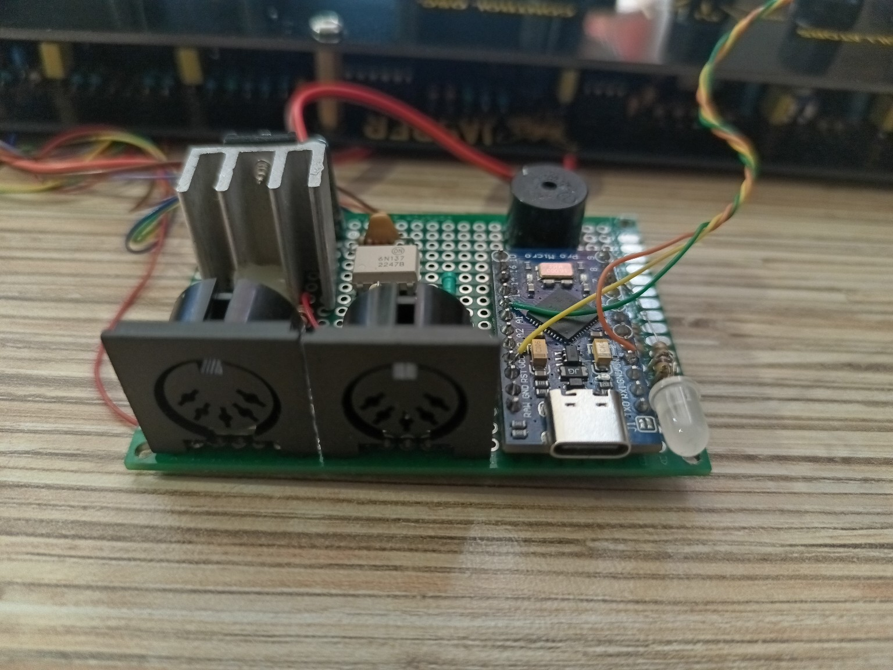
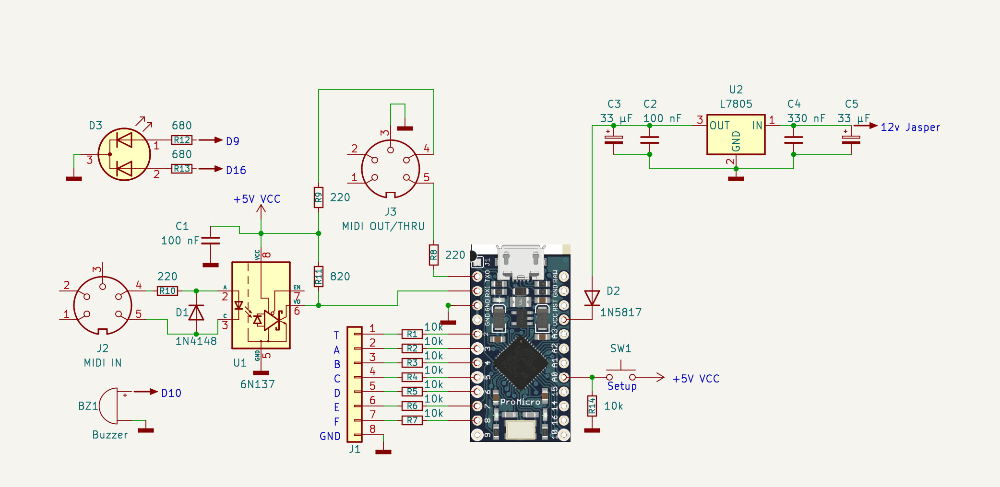
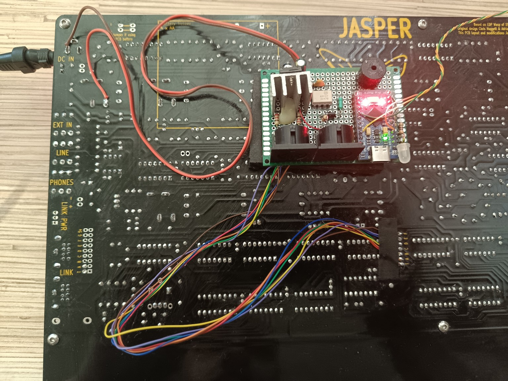

# Hardware

The current prototype is built around an **Arduino Pro Micro (ATmega32U4, 5 V / 16 MHz)** and connects to Jasper through the LINK header.

*Hand-built prototype interface board used during development and testing.*

## Schematic

*Current prototype schematic. Component designators and values correspond to the diagram above.*

### Component reference

| Ref. | Component / value | Function |
|---|---|---|
| U1 | 6N137 | high-speed optocoupler for DIN MIDI IN |
| U2 | L7805 | 5 V linear regulator from Jasper's 12 V rail |
| D1 | 1N4148 | reverse-voltage protection across the 6N137 input LED |
| D2 | 1N5817 | Schottky diode in the external 5 V feed to the Pro Micro |
| D3 | dual-colour LED, common cathode | internal / external clock indication |
| R1–R7 | 10 kΩ | series resistors for LINK T and A–F |
| R8 | 220 Ω | MIDI OUT series resistor from TX |
| R9 | 220 Ω | MIDI OUT series resistor from +5 V |
| R10 | 220 Ω | MIDI IN current-limiting resistor |
| R11 | 820 Ω | 6N137 output pull-up to +5 V |
| R12 | 680 Ω | clock LED current-limiting resistor, D9 |
| R13 | 680 Ω | clock LED current-limiting resistor, D16 |
| R14 | 10 kΩ | SET input pull-down |
| C1 | 100 nF | 6N137 supply decoupling |
| C2 | 100 nF | 7805 output bypass capacitor |
| C3 | 33 µF | 7805 output bulk capacitor |
| C4 | 330 nF | 7805 input bypass capacitor |
| C5 | 33 µF | 7805 input bulk capacitor |
| J1 | 8-pin LINK connector | T, A, B, C, D, E, F, GND |
| J2 | 5-pin DIN | MIDI IN |
| J3 | 5-pin DIN | MIDI OUT / software THRU |
| BZ1 | passive buzzer | UI, metronome and status feedback |
| SW1 | SET / Setup switch or active-high touch sensor | configuration input |
| MCU | Arduino Pro Micro, ATmega32U4, 5 V / 16 MHz | main controller |

For a mechanical SET switch, SW1 connects the SET input to +5 V. R14 keeps the input LOW while the switch is open. An active-high touch-sensor output can be connected to the same SET input without changing the firmware.

## Functional blocks

1. Jasper LINK interface
2. DIN MIDI IN with 6N137 isolation
3. DIN MIDI OUT / software THRU
4. SET control input
5. piezo buzzer
6. internal/external clock indicators
7. regulated 5 V supply

## Power

The prototype derives 5 V from the Jasper 12 V rail using U2 (L7805).

Regulator decoupling shown in the current schematic:

- input: C4 = 330 nF and C5 = 33 µF
- output: C2 = 100 nF and C3 = 33 µF

D2 is a 1N5817 Schottky diode between the regulator output and the Pro Micro external 5 V rail.

When USB and external power may be connected at the same time, verify the exact USB/VCC power topology of the particular Pro Micro clone and avoid back-feeding the computer's USB 5 V rail.

## LINK protection

The prototype uses 10 kΩ series resistors R1–R7 on T and A–F. These are intentionally retained even though the MCU operates at the same nominal 5 V logic level.

The firmware's default idle condition is high impedance, not a driven logic level.

## Jasper connection points

*Prototype connection points on a Jasper Rev 2.2. The interface board is only resting on the synthesizer PCB in this photo; this is not the final mounting position. The image is intended to show where the prototype wiring connects to the Jasper board. Final mechanical mounting will be done later in a dedicated enclosure.*

## Status

This is currently prototype documentation, not a production-ready PCB design. Verify the wiring against [../docs/wiring.md](../docs/wiring.md) before building.
